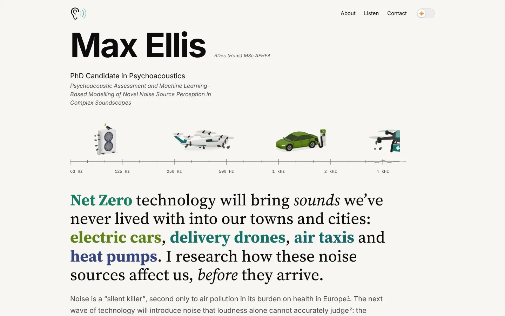
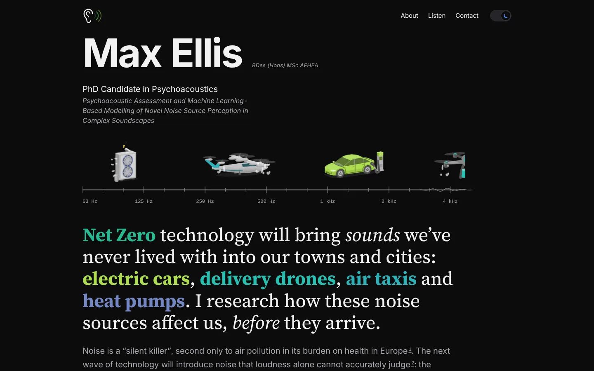

<div align="center">

# ellisacoustics.github.io

**The personal site and living CV of Max Ellis, psychoacoustician.**

[**ellisacoustics.github.io**](https://ellisacoustics.github.io) · [Download the CV (PDF)](cv/Max-Ellis-CV.pdf)


 

</div>

## What this is

A hand-built, framework-free website that doubles as a CV for a PhD researcher studying how people
perceive the sounds of drones, air taxis, heat pumps and electric vehicles. It is deliberately small:
plain HTML, one stylesheet, one script, no bundler, no runtime dependencies and no third-party requests.

| Page | Purpose |
| --- | --- |
| [`index.html`](index.html) | Home: animated frequency ruler of noise sources, research statement, publications, collaborators |
| [`about.html`](about.html) | Full CV: experience, education, memberships, volunteering, software, certificates |
| [`listen.html`](listen.html) | Sounds synthesised live in the browser with the Web Audio API (nothing is recorded or sent) |
| [`press.html`](press.html) | Press and media resources |
| [`contact.html`](contact.html) | Contact routes and the topics Max can speak on |
| [`accessibility.html`](accessibility.html), [`privacy.html`](privacy.html), [`credits.html`](credits.html) | Accessibility statement, privacy notice, credits and licences |

## Design principles

- **Fast.** The build inlines CSS and JS so the HTML is the only blocking request, and subsets the
  serif typeface to the characters each page actually uses (about 9 KB per face, WOFF2, preloaded).
- **Accessible.** WCAG 2.2 AA contrast in light and dark mode, semantic landmarks, visible focus,
  keyboard-operable controls, and every animation respects `prefers-reduced-motion`.
- **Colour-blind safe.** All data colours come from the viridis family.
- **Private by default.** No cookies, analytics or third-party hosts. The only stored value is the
  light/dark choice, kept in `localStorage` on the visitor's device.
- **Themeable.** One set of CSS custom properties drives light and dark mode, including every inline SVG illustration.

## Repository layout

```text
.
├── index.html, about.html, …   Pages, served from the site root so URLs stay stable
├── assets/
│   ├── css/                    site.css (tokens, layout) and sections.css (CV components)
│   ├── js/site.js              Theme switch, heading balancer, shared behaviour
│   ├── fonts/                  Sourcerer source fonts and per-page WOFF2 subsets (generated)
│   ├── images/                 Photographs and the social-share card
│   └── logos/                  Organisation, volunteering and software marks (light and dark)
├── cv/                         Generated CV PDF, linked from the site and from external profiles
├── papers/                     Open-access copy of the publication
├── design/originals/           Unmodified source artwork that the logos were derived from
├── docs/                       Asset licences and README screenshots
├── tools/
│   ├── build.py                Inlines CSS/JS and subsets fonts into each page
│   ├── make_cv.py              Renders the CV PDF from the live pages
│   ├── logo_mark.py, sources.py  Generators for the SVG noise-source illustrations
│   └── qa/                     HTML lint, browser smoke test, contrast audit
├── favicon*, apple-touch-icon.png, robots.txt, sitemap.xml
└── Makefile                    Shortcuts for the commands below
```

## Working on it

Requirements: Python 3.10+, plus `pip install fonttools playwright` and `playwright install chromium`
for the build, CV and browser checks. Viewing the site needs nothing but a browser.

```bash
make serve    # preview at http://localhost:8765
make build    # re-inline CSS/JS and re-subset fonts after editing assets/css or assets/js
make cv       # regenerate cv/Max-Ellis-CV.pdf after changing CV text (needs `make serve` running)
make check    # HTML lint, browser smoke test and contrast audit (needs `make serve` running)
```

Edit the readable sources in `assets/css` and `assets/js`, then run `make build`; the build rewrites
the marked blocks in each page in place, so it is safe to run repeatedly. Pushing to `main`
publishes the site through GitHub Pages.

## Credits and licence

- Source code (HTML, CSS, JavaScript, build scripts): [MIT](LICENSE).
- Text, photographs, the CV and the publication PDF are © Max Ellis, all rights reserved.
- Third-party logos remain the property of their owners; fonts and icon sets and their licences are listed in
  [`docs/asset-credits.md`](docs/asset-credits.md) and on the [credits page](https://ellisacoustics.github.io/credits.html).
